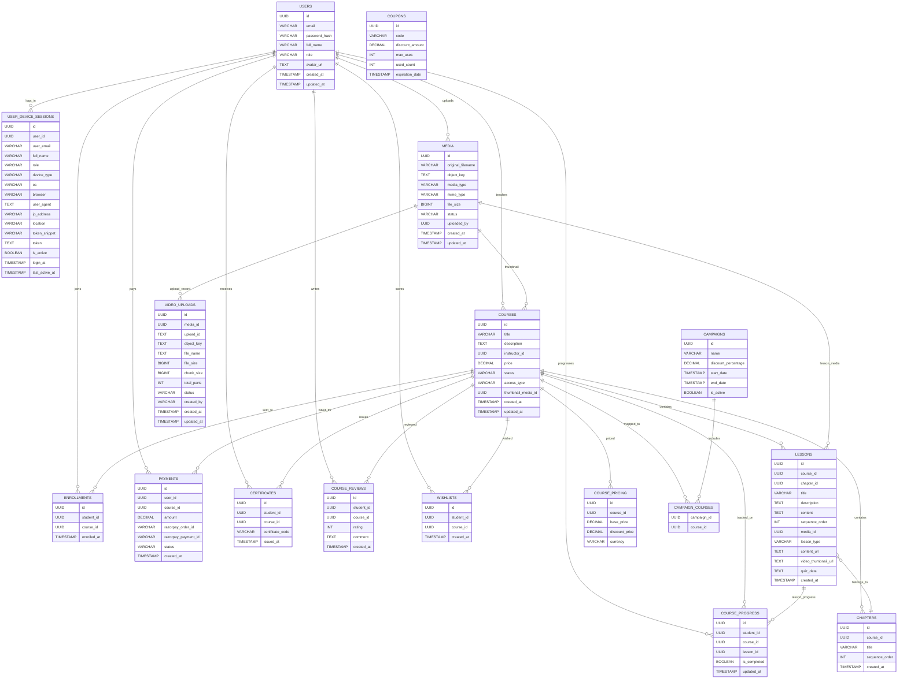

# Database Relationship Diagram

This ER diagram shows how the core tables in the learning platform relate to one another.

## Relationship summary

- USERS is the main identity node.
- COURSES is the center of content and purchase flows.
- LESSONS and CHAPTERS structure the learning content.
- ENROLLMENTS, PAYMENTS, COURSE_PROGRESS, CERTIFICATES, COURSE_REVIEWS, and WISHLISTS describe learner behavior.
- MEDIA and VIDEO_UPLOADS represent uploaded assets and storage metadata.
- CAMPAIGNS and CAMPAIGN_COURSES connect marketing offers to courses.
- USER_DEVICE_SESSIONS tracks login and device activity.

This file is ready to be pushed to GitHub and GitHub will render the Mermaid diagram automatically.
